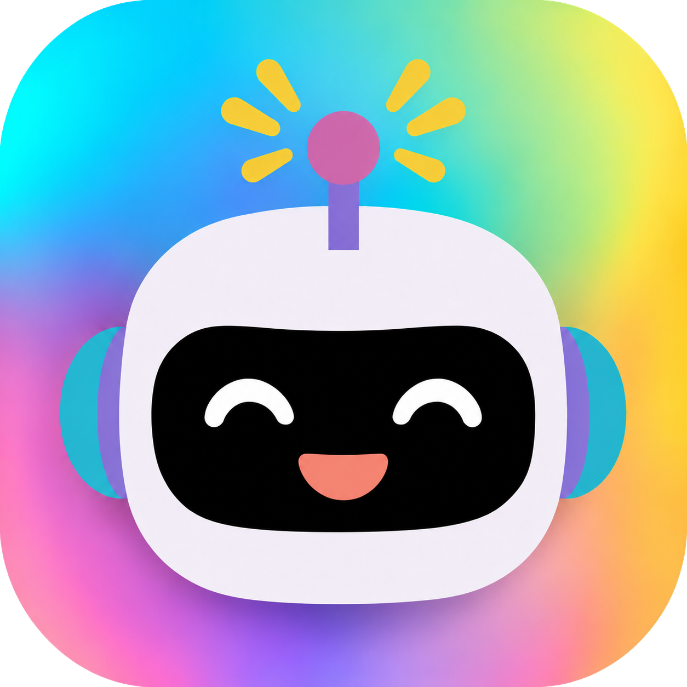

# Mod Bot

Mod Bot helps members of the Neurodiversity in Tech Slack workspace contact moderators and join configured private channels. It is a Ruby on Rails application with replies in channels and direct messages.

## Commands

- `/mods <message>` sends a report to the moderator channel and confirms delivery to the member.
- `/add-to-channel help` lists the private channels available through the bot.
- `/add-to-channel <name>` invites the member to a configured private channel.

The current channel arguments are `bipoc`, `women-nonbinary`, and `queer`. Help explains who each channel is for. Arguments also accept underscores, the `intersection-` prefix, and an optional leading `#`.

## Documentation

- [Configuration and hosting](https://github.com/nditcommunity/modbot/blob/main/docs/setup.md): NDIT's hosted bot, environment variables, channel configuration, and Slack integration.
- [Maintenance](https://github.com/nditcommunity/modbot/blob/main/docs/development.md): tests, CI, dependency updates, and deployment checks.
- [Security](https://github.com/nditcommunity/modbot/blob/main/SECURITY.md): webhook validation, privacy protections, and the Slack permission review.

## Credits

Mod Bot is a fork of [slack-pairs](https://github.com/jmkoni/slack-pairs), created by [@jmkoni](https://github.com/jmkoni). The project retains the [GNU General Public License v3.0](https://github.com/nditcommunity/modbot/blob/main/LICENSE.md).
